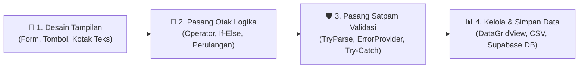

## 🗺️ Daftar Isi Modul Pembelajaran

1. **Modul 0:** Peta Materi & Bedah Lengkap Semua Tools (Visual Studio, .NET 10, WinForms, Pustaka, & Database)
2. **Modul 1 (Pertemuan 1):** Konsep Dasar Pemrograman Visual, Karakteristik, Manfaat, Keterbatasan, & Platform
3. **Modul 2 (Pertemuan 2):** Komponen Visual (`Form`, `Button`, `Label`, `TextBox`), Properti, Event, & Aturan Penamaan (*Naming Convention*)
4. **Modul 3 (Pertemuan 3):** 5 Jenis Operator, Ekspresi, & 5 Struktur Percabangan (`If`, `If-Else`, `If-ElseIf`, `Select Case`, Ternary `If()`)
5. **Modul 4 (Pertemuan 4):** Struktur Perulangan (`For...Next`, `Step`, `For Each`, `While`, `Do...Loop`, & *Nested Loop*)
6. **Modul 5 (Pertemuan 5):** `Module`, `Public` vs `Private`, `Sub` vs `Function`, `Array` (1D/2D/3D), & Koleksi Data (`List`, `Dictionary`, `HashSet`)
7. **Modul 6 (Pertemuan 6):** Database Cloud dengan PostgreSQL, Supabase, & "4 Sekawan" Npgsql (Beserta Full Code CRUD)
8. **Modul 7 (Pertemuan 7):** Validasi Input, Pembatas Ketikan (Hanya Angka / Hanya Huruf), *Error Handling* (`Try...Catch...Finally`), `ErrorProvider`, **Full Code Proyek `FormPendaftaran`**, & **Full Code Tugas `FrmPeminjamanBuku`**
9. **Modul 8 (Pertemuan 8):** `DataGridView`, `BindingSource`, `List(Of T)`, `DataTable`, Filter vs Loop, **Full Code Proyek `DataMahasiswa` (Semua File)**, & **Full Code Tugas `FrmInventarisBuku`**
10. **Modul 9:** Kamus Besar & Daftar Lengkap Semua Fungsi, Method, Properti, & Event di VB.NET
11. **Modul 10:** Kuis Interaktif Evaluasi Pemahaman (Klik untuk Buka Jawaban)

---

## 🛠️ Modul 0: Apa yang Kita Pelajari & Bedah Lengkap Semua Tools

### Apa Sebenarnya yang Diajarkan di Pemrograman Visual?
Bayangkan kamu ingin membuat aplikasi kasir minimarket, aplikasi pendaftaran mahasiswa baru, atau aplikasi perpustakaan di komputer Windows.
* **Cara Lama (Pemrograman Teks Murni):** Kamu harus mengetik ratusan baris kode hanya untuk menentukan ukuran jendela, menggambar satu kotak isian, dan mengatur posisinya di layar.
* **Cara Pemrograman Visual:** Kamu tinggal **klik, tarik, dan lepas (*drag-and-drop*)** komponen seperti tombol dan tabel ke atas kanvas (seperti menyusun balok Lego), lalu kamu fokus menulis **"otak" logika** di balik komponen tersebut menggunakan bahasa **Visual Basic .NET (VB.NET)**.



### Bedah Lengkap Peralatan Tempur (*Tools*) yang Digunakan

#### A. Peralatan Utama (Software, Bahasa & Kerangka Kerja)

| Nama Tool | Analogi Orang Awam | Penjelasan Detail & Kegunaannya |
| :--- | :--- | :--- |
| **Microsoft Visual Studio** | **Bengkel / Dapur Lengkap (IDE)** | Aplikasi utama yang kita instal di komputer. Di dalamnya sudah tersedia kanvas gambar (*Form Designer*), editor kode pintar (*IntelliSense*), dan alat penguji program (*Debugger* yang dijalankan dengan tombol **F5**). |
| **Visual Basic .NET (VB.NET)** | **Bahasa Manusia untuk Menyuruh Komputer** | Bahasa pemrograman buatan Microsoft yang kalimat kodenya sangat mirip bahasa Inggris sehari-hari (misal `If ... Then ... Else`, `For Each ... Next`), sehingga paling mudah dipahami oleh pemula. |
| **.NET (khususnya .NET 10)** | **Mesin Mobil & Suku Cadang Siap Pakai** | Kerangka kerja (*framework*) modern lintas platform dari Microsoft. Berkat `.NET`, kita tidak perlu membuat rumus pembuka file atau pengolah tabel dari nol. Pada praktikum ini kita wajib memilih template **Windows Forms App (.NET 10)**, bukan *.NET Framework* versi lama. |
| **Windows Forms (WinForms)** | **Cetakan Aplikasi Jendela Windows** | Teknologi di dalam `.NET` khusus untuk merancang aplikasi desktop berbentuk jendela (*Form*) lengkap dengan tombol klik, kotak isian, dan tabel. |

#### B. Bagian-Bagian Jendela di Dalam Visual Studio

| Bagian di Visual Studio | Analogi Orang Awam | Fungsi & Kapan Kamu Menggunakannya |
| :--- | :--- | :--- |
| **Toolbox** | **Kotak Perkakas / Etalase Komponen** | Tempat mengambil komponen visual untuk ditarik ke Form. Terbagi menjadi beberapa grup: **Common Controls** (`Button`, `Label`, `TextBox`, `ComboBox`, `ListBox`), **Data** (`DataGridView`, `BindingSource`), dan **Components** (`ErrorProvider`). |
| **Form Designer** | **Meja Gambar / Kanvas Utama** | Area kerja di tengah layar tempat kita menyusun letak tombol dan kotak teks menggunakan mouse. |
| **Properties Window** | **Panel Pengaturan Identitas & Gaya** | Biasanya di pojok kanan bawah. Dipakai untuk mengubah **`(Name)`** (nama variabel di kode), **`Text`** (tulisan yang tampil di layar), warna, dan ukuran. Memiliki **Ikon Petir (⚡ Events)** untuk membuat event khusus seperti `Validating` atau `KeyPress`. |
| **Component Tray** | **Laci Bawah Kanvas** | Area kecil di bawah Form Designer tempat menampung komponen belakang layar yang tidak punya wujud fisik di dalam Form, seperti **`ErrorProvider` (`errInput`)** dan **`BindingSource` (`bsMahasiswa`)**. |
| **Solution Explorer** | **Lemari Map Proyek** | Biasanya di pojok kanan atas. Menampilkan daftar seluruh file di proyek kita (`FrmUtama.vb`, `ModValidasi.vb`, `Mahasiswa.vb`). Klik kanan pada nama proyek di sini untuk menambah **Form**, **Module**, atau **Class** baru. |
| **Option Strict On** | **Satpam Ketat Tipe Data** | Pengaturan wajib (di *Project Properties > Compile* atau diketik di baris paling atas kode) yang melarang VB.NET menebak-nebak perubahan tipe data secara sembarangan (misal melarang teks otomatis dianggap angka tanpa konversi resmi). |

#### C. Pustaka Bawaan (*Namespaces*) & Tools Database

| Pustaka / Tool | Kode Pemanggil | Fungsi Utama dalam Praktikum Kita |
| :--- | :--- | :--- |
| **System.IO** | `Imports System.IO` | Mengurus keluar-masuk **File & Folder** di komputer. Menyediakan `Path.Combine` (menyambung alamat folder dengan aman), `StreamWriter` (menulis file CSV), dan `IOException` (mendeteksi jika file sedang dikunci Excel). |
| **System.Globalization** | `Imports System.Globalization` | Mengurus perbedaan format bahasa/negara di Windows. Menyediakan `CultureInfo.InvariantCulture` dan `NumberStyles.AllowDecimalPoint` agar input desimal titik (`3.45`) maupun koma (`3,45`) sama-sama aman dibaca. |
| **System.ComponentModel** | `Imports System.ComponentModel` | Menyediakan `CancelEventArgs` yang dibutuhkan oleh event `Validating` saat kursor berpindah dari satu kotak teks ke kotak lainnya. |
| **PostgreSQL** | Mesin Database SQL | Sistem manajemen basis data relasional (*open-source*) tempat menyimpan tabel data secara permanen. |
| **Supabase** | Cloud BaaS (*Backend-as-a-Service*) | Layanan *cloud* di internet yang menyediakan database PostgreSQL siap pakai lengkap dengan dashboard tabel, tanpa perlu repot menginstal server database di laptop. |
| **Npgsql** | `Imports Npgsql` (via NuGet) | Paket jembatan penghubung (*driver ADO.NET*) yang diinstal lewat *NuGet Package Manager* agar aplikasi VB.NET bisa mengirim dan mengambil data dari PostgreSQL/Supabase. |

---

## 🎨 Modul 1 (Pertemuan 1): Pengenalan Pemrograman Visual

* **Pengertian Visual Programming:** Pendekatan pengembangan program melalui manipulasi elemen-elemen grafis (seperti blok, diagram, dan komponen visual) sebagai representasi dari struktur serta logika program.
* **3 Karakteristik Utama:**
  1. Logika program direpresentasikan melalui blok, diagram, atau elemen grafis yang saling terhubung sesuai alur program.
  2. Komponen program maupun antarmuka dapat disusun melalui mekanisme **drag-and-drop**, sehingga perancangan menjadi lebih intuitif.
  3. Perubahan pada rancangan atau struktur program dapat diamati secara langsung, sehingga memudahkan evaluasi dan pengembangan.
* **Tujuan & Manfaat:** Mempermudah pemahaman konsep dasar pemrograman, menyajikan alur program secara visual dan terstruktur, mempersiapkan pengguna sebelum mempelajari sintaks kode yang kompleks, dan meminimalkan kesalahan penulisan kode.
* **3 Keterbatasan:**
  1. **Fleksibilitas Terbatas:** Terbatas pada komponen dan fitur yang disediakan oleh platform.
  2. **Kurang Efisien untuk Proyek Besar:** Proyek berskala sangat besar menjadi rumit jika tidak dikelola dengan arsitektur kode yang terpisah.
  3. **Ketergantungan pada Platform:** Bergantung pada IDE dan sistem operasi tempat aplikasi tersebut dibangun.
* **Contoh Platform:**
  * **Scratch & MIT App Inventor:** Pemrograman visual murni berbasis penyusunan blok *puzzle*.
  * **Visual Basic (.NET) & JavaFX:** Pemrograman visual berbasis perancangan komponen GUI (*drag-and-drop*) yang dipadukan dengan penulisan kode berbasis *event*.

---

## 🖼️ Modul 2 (Pertemuan 2): Komponen Visual, Properti, Event & Naming Convention

### 1. Memahami Control, Property, dan Event
* **Control (Komponen Visual):** Elemen antarmuka pengguna (UI) di Toolbox yang ditaruh di atas Form agar pengguna bisa berinteraksi melalui input dan output.
* **Property (Properti):** Pengaturan karakteristik suatu komponen (seperti nama identitas `(Name)`, tulisan `Text`, warna `BackColor`, ukuran `ClientSize`).
* **Event (Kejadian):** Peristiwa yang terjadi pada komponen (karena klik mouse, ketikan keyboard, atau perpindahan kursor) yang memicu jalannya baris kode program.

### 2. Daftar Properti Dasar Form & Komponen

| Nama Properti | Berlaku Pada | Penjelasan Detail & Kegunaan |
| :--- | :--- | :--- |
| **`(Name)`** | Semua Kontrol | Identitas unik komponen yang dipakai di dalam kode program untuk pemanggilan (contoh: `txtNama`, `btnSimpan`). |
| **`Text`** | Semua Kontrol | Teks atau tulisan yang terlihat oleh mata pengguna pada permukaan komponen atau judul jendela Form. |
| **`ClientSize`** | Khusus `Form` | Ukuran area kerja bagian dalam Form dalam satuan piksel `(Lebar; Tinggi)`, misal `420; 220`. |
| **`StartPosition`** | Khusus `Form` | Posisi awal Form saat dijalankan (`CenterScreen` = tampil tepat di tengah layar). |
| **`FormBorderStyle`** | Khusus `Form` | Gaya bingkai jendela (`FixedSingle` = ukuran jendela dikunci agar tidak bisa ditarik melebar oleh pengguna). |
| **`MaximizeBox`** | Khusus `Form` | Menentukan apakah tombol *Maximize* di pojok kanan atas aktif (`False` = dinonaktifkan). |
| **`AcceptButton`** | Khusus `Form` | Menentukan tombol mana yang otomatis terpencet saat pengguna menekan **Enter** di keyboard (misal `btnSimpan`). |
| **`BackColor` & `ForeColor`** | Semua Kontrol | Mengatur warna latar belakang (`BackColor`) dan warna teks/tulisan (`ForeColor`). |
| **`Font`** | Semua Kontrol | Mengatur jenis huruf, ukuran, dan gaya tebal/miring (contoh: `Segoe UI, 14pt, Bold`). |
| **`Enabled`** | Semua Kontrol | Menentukan apakah komponen aktif dan bisa digunakan oleh pengguna (`True` atau `False`). |
| **`Visible`** | Semua Kontrol | Menentukan apakah komponen ditampilkan (`True`) atau disembunyikan (`False`). |
| **`MaxLength`** | `TextBox` | Membatasi jumlah karakter maksimal yang bisa diketik di dalam TextBox (contoh: `MaxLength = 9` untuk NIM). |
| **`DropDownStyle`** | `ComboBox` | Diatur ke **`DropDownList`** agar pengguna hanya bisa memilih dari daftar yang tersedia dan tidak bisa mengetik bebas. |
| **`CausesValidation`** | `Button` | Diatur ke **`False`** pada tombol seperti `btnBersihkan` atau `btnEkspor` agar bisa langsung diklik tanpa memicu event `Validating` dari kontrol lain. |

### 3. Aturan Penamaan Kontrol (*Naming Convention* — Pola `prefix + NamaFungsi`)

| Jenis Kontrol | Prefix Wajib | Contoh `(Name)` |
| :--- | :---: | :--- |
| **Form** | `frm` / `Frm` | `FrmUtama`, `FrmUjiKonversi`, `FrmPendaftaran` |
| **Label** | `lbl` | `lblJudul`, `lblNim`, `lblHasil`, `lblStatus`, `lblJumlah` |
| **TextBox** | `txt` | `txtNim`, `txtNama`, `txtAngkatan`, `txtIpk`, `txtInput`, `txtCari` |
| **Button** | `btn` | `btnSimpan`, `btnBersihkan`, `btnEkspor`, `btnTambah`, `btnRapikan` |
| **ComboBox** | `cbo` | `cboJurusan`, `cboKategori` |
| **ListBox** | `lst` | `lstMahasiswa`, `lstPeminjaman` |
| **DataGridView** | `dgv` | `dgvMahasiswa`, `dgvBuku` |
| **DateTimePicker** | `dtp` | `dtpTanggalLahir`, `dtpPinjam` |
| **CheckBox / RadioButton / GroupBox** | `chk` / `rdo` / `grp` | `chkSetuju`, `rdoLakiLaki`, `grpDataDiri` |
| **ErrorProvider** | `err` | `errInput` |
| **BindingSource** | `bs` | `bsMahasiswa`, `bsBuku` |

### 4. Contoh Kode Utuh Interaksi Dasar Pertemuan 2

```vbnet
Option Strict On

Public Class FrmLatihanKomponen
    ' Event Click pada Button: berjalan saat pengguna mengklik tombol btnTampilkan
    Private Sub btnTampilkan_Click(sender As Object, e As EventArgs) Handles btnTampilkan.Click
        ' Mengambil isi ketikan dari txtNama dan menampilkannya pada lblHasil
        lblHasil.Text = "Halo, " & txtNama.Text & "! Selamat datang di Pemrograman Visual."
    End Sub

    ' Event Click untuk mereset/mengosongkan TextBox dan mengembalikan fokus kursor
    Private Sub btnKosongkan_Click(sender As Object, e As EventArgs) Handles btnKosongkan.Click
        txtNama.Clear()
        lblHasil.Text = "Silakan ketik nama Anda."
        txtNama.Focus()
    End Sub
End Class
```

---

## 🔀 Modul 3 (Pertemuan 3): Operator, Ekspresi & Percabangan

### 1. Tabel Lengkap 5 Jenis Operator di VB.NET

| Kategori Operator | Operator di VB.NET | Contoh Penggunaan | Penjelasan Lengkap |
| :--- | :--- | :--- | :--- |
| **1. Aritmatika** | `+`, `-`, `*`, `/`, `\`, `Mod` | `Dim a As Double = 10 / 4` (`2.5`)<br>`Dim b As Integer = 10 \ 4` (`2`)<br>`Dim c As Integer = 10 Mod 3` (`1`) | `+` (tambah), `-` (kurang), `*` (kali), `/` (bagi desimal), **`\` (bagi bulat: membuang angka di belakang koma)**, **`Mod` (sisa pembagian)**. |
| **2. Penugasan** | `=`, `+=`, `-=`, `*=`, `/=`, `\=`, `&=` | `x = 10`<br>`x += 5` *(ekuivalen `x = x + 5`)*<br>`teks &= " Baru"` | Memberikan nilai atau memodifikasi nilai variabel yang sudah ada. Operator `&=` khusus untuk menyambung teks (`String`). |
| **3. Perbandingan** | `=`, `<>`, `>`, `<`, `>=`, `<=` | `5 = 5` (`True`)<br>`5 <> 3` (`True`)<br>`angka >= 2015` | Membandingkan dua nilai dan menghasilkan `Boolean` (`True` atau `False`). Simbol **`<>`** berarti **Tidak Sama Dengan**. |
| **4. Logika** | `And`, `AndAlso`, `Or`, `OrElse`, `Not`, `Xor`, `Not (A Or B)` (NOR), `Not (A And B)` (NAND) | `If Not Kosong(teks) AndAlso teks.Length = 9 Then` | • **`And` / `AndAlso`:** `True` jika semua kondisi benar.<br>• **`Or` / `OrElse`:** `True` jika minimal satu kondisi benar.<br>• **`Not`:** Membalikkan nilai logika.<br>• **`Xor`:** `True` jika tepat satu kondisi benar.<br>*(Gunakan `AndAlso` & `OrElse` agar pengecekan berhenti otomatis begitu hasil akhir sudah pasti!)* |
| **5. Increment & Decrement** | `x += 1`, `x -= 1` | `jumlah += 1`<br>`sisa -= 1` | Menambah 1 (*increment*) atau mengurangi 1 (*decrement*) pada variabel angka. |

### 2. Kode Lengkap 5 Bentuk Percabangan di VB.NET

```vbnet
Option Strict On

Public Class FrmContohPercabangan
    Private Sub EvaluasiNilai(nilai As Integer, kodeJurusan As String)
        Dim keterangan As String = ""

        ' 1. IF STATEMENT (Satu blok pilihan saat kondisi bernilai True)
        If nilai = 100 Then
            MessageBox.Show("Selamat! Anda mendapatkan nilai sempurna.")
        End If

        ' 2. IF - ELSE STATEMENT (Dua jalur: satu blok jika True, blok lain jika False)
        If nilai >= 60 Then
            keterangan = "Lulus"
        Else
            keterangan = "Tidak Lulus"
        End If

        ' 3. IF - ELSEIF - ELSE STATEMENT (Memeriksa beberapa rentang kondisi secara berurutan)
        Dim nilaiHuruf As String
        If nilai >= 85 Then
            nilaiHuruf = "A (Sangat Baik)"
        ElseIf nilai >= 75 Then
            nilaiHuruf = "B (Baik)"
        ElseIf nilai >= 60 Then
            nilaiHuruf = "C (Cukup)"
        Else
            nilaiHuruf = "D (Kurang)"
        End If

        ' 4. SELECT CASE / SWITCH STATEMENT (Lebih rapi daripada If-ElseIf untuk memilih berdasarkan nilai variabel)
        Dim namaJurusan As String
        Select Case kodeJurusan.ToUpper()
            Case "TI"
                namaJurusan = "Teknik Informatika"
            Case "SI"
                namaJurusan = "Sistem Informasi"
            Case "MI", "TK"
                namaJurusan = "Manajemen Informatika / Teknik Komputer"
            Case Else
                namaJurusan = "Jurusan Tidak Dikenal"
        End Select

        ' 5. OPERATOR TERNARY If(kondisi, nilaiJikaTrue, nilaiJikaFalse) — Percabangan singkat 1 baris
        Dim statusBeasiswa As String = If(nilai >= 85, "Berhak Beasiswa", "Belum Berhak")
    End Sub
End Class
```

---

## 🔄 Modul 4 (Pertemuan 4): Struktur Perulangan (*Looping*)

### Kode Lengkap Semua Jenis Perulangan (`For...Next`, `Step`, `While`, `Do...Loop`, `Nested Loop`)

```vbnet
Option Strict On

Public Class FrmContohPerulangan
    ' 1. FOR - NEXT NAIK (Counted Loop: jumlah pengulangan sudah pasti dari 1 sampai 5)
    Private Sub ContohForNaik()
        lstOutput.Items.Clear()
        For i As Integer = 1 To 5
            lstOutput.Items.Add("Iterasi naik ke-" & i.ToString())
        Next
    End Sub

    ' 2. FOR - NEXT TURUN DENGAN STEP -1 (Menurunkan nilai variabel pengontrol setiap iterasi)
    Private Sub ContohForTurun()
        lstOutput.Items.Clear()
        For i As Integer = 10 To 1 Step -1
            lstOutput.Items.Add("Hitung mundur: " & i.ToString())
        Next
    End Sub

    ' 3. WHILE - END WHILE (Uncounted Loop — Kondisi dicek di AWAL: jika awal False, tidak jalan sama sekali)
    Private Sub ContohWhileAwal()
        lstOutput.Items.Clear()
        Dim i As Integer = 1
        While i <= 5
            lstOutput.Items.Add("While (cek di awal): " & i.ToString())
            i += 1
        End While
    End Sub

    ' 4. DO WHILE ... LOOP (Kondisi dicek di AWAL) vs DO ... LOOP WHILE (Kondisi dicek di AKHIR)
    Private Sub ContohDoLoop()
        lstOutput.Items.Clear()

        ' A. Kondisi dicek di awal:
        Dim a As Integer = 1
        Do While a <= 5
            lstOutput.Items.Add("Do While (awal): " & a.ToString())
            a += 1
        Loop

        ' B. Kondisi dicek di akhir (Minimal pasti dijalankan SATU KALI meskipun kondisi awalnya False):
        Dim b As Integer = 99
        Do
            lstOutput.Items.Add("Do...Loop While (akhir) tetap tampil 1 kali meskipun b = " & b.ToString())
            b += 1
        Loop While b <= 5
    End Sub

    ' 5. NESTED LOOP (Perulangan di dalam perulangan: perulangan dalam selesai penuh untuk tiap 1 putaran luar)
    Private Sub ContohNestedLoop()
        lstOutput.Items.Clear()
        For i As Integer = 1 To 3
            For j As Integer = 1 To 3
                lstOutput.Items.Add(i.ToString() & " - " & j.ToString())
            Next
        Next
    End Sub
End Class
```

---

## 📦 Modul 5 (Pertemuan 5): Modul, Fungsi, Array & Koleksi Data

### Kode Lengkap `Module`, `Public` vs `Private`, `Sub` vs `Function`, `Array` (1D/2D/3D) & 4 Koleksi Data

```vbnet
Option Strict On

' 1. MODULE, ACCESS MODIFIER (Public vs Private), PROCEDURE (Sub) & FUNCTION
Public Module ModPerhitungan
    ' Public: Dapat diakses oleh Form atau Module lain di seluruh proyek
    Public nilaiUmum As Integer = 80

    ' Private: Hanya dapat diakses dari dalam ModPerhitungan ini saja
    Private rahasiaInternal As Integer = 100

    ' Procedure (Sub): Melakukan tugas tertentu tanpa mengembalikan nilai
    Public Sub TampilkanPesan()
        MessageBox.Show("Halo dari Procedure! Nilai internal = " & rahasiaInternal.ToString())
    End Sub

    ' Function: Melakukan proses perhitungan dan MENGEMBALIKAN NILAI dengan kata kunci Return
    Public Function HitungLuas(panjang As Integer, lebar As Integer) As Integer
        Return panjang * lebar
    End Function
End Module

' 2. CONTOH LENGKAP ARRAY (1D, 2D, 3D) DAN KOLEKSI DATA (List, Dictionary, HashSet)
Public Class FrmKoleksiData
    Private Sub DemoArrayDanKoleksi()
        ' A. Array Satu Dimensi (Indeks dimulai dari 0: indeks 0=10, 1=20, 2=30, 3=40, 4=50)
        Dim nilai() As Integer = {10, 20, 30, 40, 50}
        Dim elemenKetiga As Integer = nilai(2)              ' Hasil: 30

        ' B. Array Dua Dimensi (Baris x Kolom)
        Dim matriks(,) As Integer = {
            {10, 20, 30},
            {40, 50, 60},
            {70, 80, 90}
        }
        Dim baris1Kolom2 As Integer = matriks(1, 2)         ' Hasil: 60

        ' C. Array Tiga Dimensi (Kedalaman/Blok x Baris x Kolom)
        Dim ruang3D(,,) As Integer = {
            {{1, 2, 3}, {4, 5, 6}, {7, 8, 9}},
            {{10, 11, 12}, {13, 14, 15}, {16, 17, 18}}
        }
        Dim isi3D As Integer = ruang3D(1, 2, 0)             ' Hasil: 16

        ' D. List(Of T): Koleksi dinamis yang bisa bertambah (.Add) dan berkurang (.Remove)
        Dim daftarAngka As New List(Of Integer)
        daftarAngka.Add(10)
        daftarAngka.Add(20)
        daftarAngka.Add(30)
        daftarAngka.Remove(20)                              ' Menghapus nilai 20; sisa 2 elemen (Count = 2)

        ' E. Dictionary(Of TKey, TValue): Menyimpan pasangan Key-Value (Kunci unik & Nilai)
        Dim mhs As New Dictionary(Of String, String)
        mhs.Add("NIM", "241712051")
        mhs.Add("Nama", "Nadya")
        mhs.Add("Prodi", "Sistem Informasi")
        Dim namaMahasiswa As String = mhs("Nama")           ' Diakses memakai Key "Nama" -> Hasil: "Nadya"

        ' F. HashSet(Of T) (Set): Koleksi data unik yang otomatis menolak duplikasi
        Dim himpunanUnik As New HashSet(Of Integer)
        himpunanUnik.Add(10)
        himpunanUnik.Add(20)
        himpunanUnik.Add(20)                                ' Duplikat! Tidak akan ditambahkan
        Dim totalUnik As Integer = himpunanUnik.Count       ' Hasil: tetap 2
    End Sub
End Class
```

---

## 🗄️ Modul 6 (Pertemuan 6): Database PostgreSQL, Supabase & Npgsql

### Ringkasan Konsep & Kode Lengkap CRUD (`FrmDatabaseSupabase.vb`)
* **`NpgsqlConnection`:** Membuka jalur koneksi fisik ke PostgreSQL/Supabase.
* **`NpgsqlCommand`:** Mengeksekusi perintah SQL (`SELECT`, `INSERT`, `UPDATE`, `DELETE`) dengan parameter `@` yang aman.
* **`NpgsqlDataAdapter`:** Mengambil data tabel ke `DataTable` (`.Fill()`) dan mengirim perubahan kembali ke database (`.Update()`).
* **`NpgsqlCommandBuilder`:** Membuatkan perintah `INSERT`, `UPDATE`, dan `DELETE` secara otomatis untuk `NpgsqlDataAdapter`.

```vbnet
Option Strict On

Imports System.Data
Imports Npgsql

Public Class FrmDatabaseSupabase
    Private ReadOnly connString As String =
        "Host=aws-0-ap-southeast-1.pooler.supabase.com;Port=5432;Database=postgres;Username=postgres.xxxx;Password=rahasia;SSL Mode=Require;Trust Server Certificate=true"

    Private adapter As NpgsqlDataAdapter
    Private tabelMahasiswa As DataTable

    Private Sub FrmDatabaseSupabase_Load(sender As Object, e As EventArgs) Handles MyBase.Load
        MuatData()
    End Sub

    ' 1. READ: Menampilkan tabel dari Supabase ke DataGridView
    Private Sub MuatData()
        Try
            Dim conn As New NpgsqlConnection(connString)
            adapter = New NpgsqlDataAdapter("SELECT nim, nama, jurusan, angkatan, ipk FROM mahasiswa ORDER BY nim", conn)
            Dim builder As New NpgsqlCommandBuilder(adapter)

            tabelMahasiswa = New DataTable("Mahasiswa")
            adapter.Fill(tabelMahasiswa)
            dgvMahasiswa.DataSource = tabelMahasiswa
            lblStatus.Text = "Total data di database: " & tabelMahasiswa.Rows.Count.ToString()
        Catch ex As Exception
            MessageBox.Show("Gagal memuat data: " & ex.Message, "Error Koneksi")
        End Try
    End Sub

    ' 2. CREATE (INSERT): Menambah baris baru ke Supabase dengan NpgsqlCommand
    Private Sub btnTambah_Click(sender As Object, e As EventArgs) Handles btnTambah.Click
        Try
            Using conn As New NpgsqlConnection(connString)
                conn.Open()
                Dim sql As String = "INSERT INTO mahasiswa (nim, nama, jurusan, angkatan, ipk) VALUES (@nim, @nama, @jurusan, @angkatan, @ipk)"
                Using cmd As New NpgsqlCommand(sql, conn)
                    cmd.Parameters.AddWithValue("@nim", txtNim.Text.Trim())
                    cmd.Parameters.AddWithValue("@nama", txtNama.Text.Trim())
                    cmd.Parameters.AddWithValue("@jurusan", cboJurusan.Text)
                    cmd.Parameters.AddWithValue("@angkatan", Integer.Parse(txtAngkatan.Text))
                    cmd.Parameters.AddWithValue("@ipk", Decimal.Parse(txtIpk.Text))
                    cmd.ExecuteNonQuery()
                End Using
            End Using
            MuatData()
            lblStatus.Text = "Data berhasil ditambahkan ke Supabase."
        Catch ex As Exception
            MessageBox.Show("Gagal menambah data: " & ex.Message, "Error Insert")
        End Try
    End Sub

    ' 3. UPDATE: Mengubah data mahasiswa berdasarkan NIM
    Private Sub btnUbah_Click(sender As Object, e As EventArgs) Handles btnUbah.Click
        Try
            Using conn As New NpgsqlConnection(connString)
                conn.Open()
                Dim sql As String = "UPDATE mahasiswa SET nama=@nama, jurusan=@jurusan, angkatan=@angkatan, ipk=@ipk WHERE nim=@nim"
                Using cmd As New NpgsqlCommand(sql, conn)
                    cmd.Parameters.AddWithValue("@nim", txtNim.Text.Trim())
                    cmd.Parameters.AddWithValue("@nama", txtNama.Text.Trim())
                    cmd.Parameters.AddWithValue("@jurusan", cboJurusan.Text)
                    cmd.Parameters.AddWithValue("@angkatan", Integer.Parse(txtAngkatan.Text))
                    cmd.Parameters.AddWithValue("@ipk", Decimal.Parse(txtIpk.Text))
                    cmd.ExecuteNonQuery()
                End Using
            End Using
            MuatData()
            lblStatus.Text = "Data berhasil diperbarui."
        Catch ex As Exception
            MessageBox.Show("Gagal mengubah data: " & ex.Message, "Error Update")
        End Try
    End Sub

    ' 4. DELETE: Menghapus data mahasiswa berdasarkan NIM
    Private Sub btnHapus_Click(sender As Object, e As EventArgs) Handles btnHapus.Click
        Try
            Using conn As New NpgsqlConnection(connString)
                conn.Open()
                Dim sql As String = "DELETE FROM mahasiswa WHERE nim=@nim"
                Using cmd As New NpgsqlCommand(sql, conn)
                    cmd.Parameters.AddWithValue("@nim", txtNim.Text.Trim())
                    cmd.ExecuteNonQuery()
                End Using
            End Using
            MuatData()
            lblStatus.Text = "Data berhasil dihapus."
        Catch ex As Exception
            MessageBox.Show("Gagal menghapus data: " & ex.Message, "Error Delete")
        End Try
    End Sub
End Class
```

---

## 🛡️ Modul 7 (Pertemuan 7): Validasi Input, Pembatas Ketikan (Hanya Nomor / Huruf), & Proyek `FormPendaftaran`

### 1. Kumpulan Lengkap Fungsi Validasi & Pembatas Input (Hanya Angka, Hanya Huruf, Alfanumerik, & KeyPress)

Saat membangun form input, ada **dua cara** untuk membatasi agar pengguna hanya memasukkan nomor atau hanya huruf:
1. **Cara 1 — Pengecekan Teks via Fungsi di `ModValidasi.vb`:** Memeriksa seluruh isi `TextBox.Text` saat tombol Simpan diklik atau saat event `Validating`.
2. **Cara 2 — Pencegahan Ketikan Langsung via Event `KeyPress`:** Mengunci keyboard secara *real-time* sehingga tombol huruf tidak akan muncul sama sekali saat diketik di kotak angka (atau sebaliknya, tombol angka ditolak saat diketik di kotak Nama).

Berikut adalah kode lengkap **semua fungsi pembatas input** yang wajib kamu miliki:

```vbnet
Option Strict On

Imports System.Globalization

Public Module ModValidasiLengkap

    ' =========================================================================
    ' A. FUNGSI VALIDASI WAJIB DI PRAKTIKUM (ModValidasi.vb)
    ' =========================================================================

    ' 1. Mengecek apakah teks kosong atau hanya berisi spasi
    Public Function Kosong(teks As String) As Boolean
        Return teks.Trim() = ""
    End Function

    ' 2. Mengecek apakah teks terdiri dari angka 0-9 dengan panjang yang TEPAT (misal NIM wajib 9 digit)
    Public Function SemuaDigit(teks As String, panjang As Integer) As Boolean
        If teks.Length <> panjang Then Return False
        For Each karakter As Char In teks
            If karakter < "0"c OrElse karakter > "9"c Then Return False
        Next
        Return True
    End Function

    ' 3. Mengonversi teks desimal (koma maupun titik) menjadi Decimal secara aman di semua bahasa Windows
    Public Function CobaDesimal(teks As String, ByRef hasil As Decimal) As Boolean
        Dim teksTitik As String = teks.Trim().Replace(",", ".")
        Return Decimal.TryParse(teksTitik, NumberStyles.AllowDecimalPoint,
                                CultureInfo.InvariantCulture, hasil)
    End Function

    ' =========================================================================
    ' B. FUNGSI VALIDASI TAMBAHAN (Hanya Angka, Hanya Huruf, Alfanumerik, Kode)
    ' =========================================================================

    ' 4. HANYA ANGKA (Tanpa batas panjang tertentu, minimal 1 digit angka)
    Public Function HanyaAngka(teks As String) As Boolean
        Dim rapi As String = teks.Trim()
        If rapi = "" Then Return False
        For Each karakter As Char In rapi
            If Not Char.IsDigit(karakter) Then Return False
        Next
        Return True
    End Function

    ' 5. HANYA HURUF DAN SPASI (Cocok untuk memvalidasi Nama Orang agar tidak bisa diisi angka/simbol)
    Public Function HanyaHurufDanSpasi(teks As String) As Boolean
        Dim rapi As String = teks.Trim()
        If rapi = "" Then Return False
        For Each karakter As Char In rapi
            If Not (Char.IsLetter(karakter) OrElse Char.IsWhiteSpace(karakter)) Then
                Return False
            End If
        Next
        Return True
    End Function

    ' 6. HANYA HURUF TANPA SPASI (Cocok untuk satu kata atau kode huruf murni)
    Public Function HanyaHuruf(teks As String) As Boolean
        Dim rapi As String = teks.Trim()
        If rapi = "" Then Return False
        For Each karakter As Char In rapi
            If Not Char.IsLetter(karakter) Then Return False
        Next
        Return True
    End Function

    ' 7. HANYA HURUF DAN ANGKA / ALFANUMERIK (Menolak simbol khusus seperti @#$%^&*)
    Public Function HanyaAlfanumerik(teks As String) As Boolean
        Dim rapi As String = teks.Trim()
        If rapi = "" Then Return False
        For Each karakter As Char In rapi
            If Not Char.IsLetterOrDigit(karakter) Then Return False
        Next
        Return True
    End Function

    ' 8. VALIDASI PANJANG TEKS MINIMAL & MAKSIMAL (Misal nama minimal 3 karakter)
    Public Function PanjangValid(teks As String, minPanjang As Integer, maksPanjang As Integer) As Boolean
        Dim p As Integer = teks.Trim().Length
        Return p >= minPanjang AndAlso p <= maksPanjang
    End Function

    ' 9. VALIDASI FORMAT KODE AWALAN + DIGIT ANGKA (Misal "BK" + 4 digit angka -> "BK0012")
    Public Function ValidFormatKode(teks As String, awalan As String, jumlahDigit As Integer) As Boolean
        Dim rapi As String = teks.Trim().ToUpper()
        Dim awalanBesar As String = awalan.ToUpper()
        If rapi.Length <> (awalanBesar.Length + jumlahDigit) Then Return False
        If Not rapi.StartsWith(awalanBesar) Then Return False
        Dim bagianAngka As String = rapi.Substring(awalanBesar.Length, jumlahDigit)
        Return SemuaDigit(bagianAngka, jumlahDigit)
    End Function

End Module
```

#### Cara Membatasi Ketikan Keyboard Secara Langsung dengan Event `KeyPress`
Jika kamu ingin agar **kotak teks langsung menolak ketikan yang salah saat tombol keyboard ditekan** (misalnya di `txtNim` pengguna menekan huruf `A`, dan huruf `A` tersebut langsung diblokir tidak bisa muncul di layar), gunakan **`e.Handled = True`** pada event **`KeyPress`**:

```vbnet
' 1. MEMBATASI TEXTBOX HANYA BISA DIKETIK ANGKA / NOMOR (dan tombol Backspace)
Private Sub txtHanyaAngka_KeyPress(sender As Object, e As KeyPressEventArgs) Handles txtNim.KeyPress, txtAngkatan.KeyPress
    ' Char.IsControl(e.KeyChar) mengizinkan tombol Backspace agar pengguna tetap bisa menghapus ketikan
    If Not (Char.IsDigit(e.KeyChar) OrElse Char.IsControl(e.KeyChar)) Then
        e.Handled = True    ' Batalkan/tolak ketikan tombol tersebut!
    End If
End Sub

' 2. MEMBATASI TEXTBOX HANYA BISA DIKETIK HURUF DAN SPASI (Cocok untuk txtNama)
Private Sub txtHanyaHuruf_KeyPress(sender As Object, e As KeyPressEventArgs) Handles txtNama.KeyPress
    If Not (Char.IsLetter(e.KeyChar) OrElse Char.IsWhiteSpace(e.KeyChar) OrElse Char.IsControl(e.KeyChar)) Then
        e.Handled = True    ' Tolak angka dan simbol pada kotak Nama!
    End If
End Sub

' 3. MEMBATASI TEXTBOX HANYA ANGKA DESIMAL (Mengizinkan digit angka, Backspace, serta 1 tanda koma atau titik)
Private Sub txtDesimal_KeyPress(sender As Object, e As KeyPressEventArgs) Handles txtIpk.KeyPress
    Dim kotak As TextBox = DirectCast(sender, TextBox)
    Dim adalahPemisah As Boolean = (e.KeyChar = ","c OrElse e.KeyChar = "."c)

    If Char.IsDigit(e.KeyChar) OrElse Char.IsControl(e.KeyChar) Then
        Return ' Izinkan angka dan Backspace
    ElseIf adalahPemisah AndAlso Not kotak.Text.Contains(",") AndAlso Not kotak.Text.Contains(".") Then
        Return ' Izinkan tanda koma/titik HANYA jika di dalam kotak belum ada koma atau titik sebelumnya
    Else
        e.Handled = True ' Tolak karakter lainnya
    End If
End Sub
```

---

### 💻 Semua File Kode Utuh Proyek Pertemuan 7: `FormPendaftaran`

#### File 1: `ModValidasi.vb` (Full Code)

```vbnet
Option Strict On

Imports System.Globalization

' Kumpulan fungsi validasi yang bisa dipakai ulang oleh form mana pun
Public Module ModValidasi

    ' True jika teks kosong atau hanya berisi spasi
    Public Function Kosong(teks As String) As Boolean
        Return teks.Trim() = ""
    End Function

    ' True jika panjang teks tepat sesuai dan semua karakternya digit 0-9
    Public Function SemuaDigit(teks As String, panjang As Integer) As Boolean
        If teks.Length <> panjang Then Return False
        For Each karakter As Char In teks
            If karakter < "0"c OrElse karakter > "9"c Then Return False
        Next
        Return True
    End Function

    ' Mengubah teks desimal menjadi Decimal. Koma dan titik sama-sama diterima,
    ' sehingga hasilnya tidak bergantung pada pengaturan bahasa Windows.
    Public Function CobaDesimal(teks As String, ByRef hasil As Decimal) As Boolean
        Dim teksTitik As String = teks.Trim().Replace(",", ".")
        Return Decimal.TryParse(teksTitik, NumberStyles.AllowDecimalPoint,
                                CultureInfo.InvariantCulture, hasil)
    End Function

End Module
```

#### File 2: `FrmUtama.vb` — Proyek `FormPendaftaran` (Full Code)

```vbnet
Option Strict On

Public Class FrmUtama
    ' Membuka contoh konversi input.
    Private Sub btnUjiKonversi_Click(sender As Object, e As EventArgs) Handles btnUjiKonversi.Click
        Dim frm As New FrmUjiKonversi()
        frm.ShowDialog()
    End Sub

    ' Membuka studi kasus pendaftaran.
    Private Sub btnPendaftaran_Click(sender As Object, e As EventArgs) Handles btnPendaftaran.Click
        Dim frm As New FrmPendaftaran()
        frm.ShowDialog()
    End Sub
End Class
```

#### File 3: `FrmUjiKonversi.vb` (Full Code)

```vbnet
Option Strict On

Public Class FrmUjiKonversi
    ' Tanpa penanganan error: input "abc" membuat program berhenti (InvalidCastException)
    Private Sub btnCInt_Click(sender As Object, e As EventArgs) Handles btnCInt.Click
        Dim angka As Integer = CInt(txtInput.Text)
        lblHasil.Text = "CInt berhasil: " & angka.ToString()
    End Sub

    ' Val tidak pernah error, tetapi diam-diam menghasilkan angka yang bisa salah
    Private Sub btnVal_Click(sender As Object, e As EventArgs) Handles btnVal.Click
        Dim angka As Double = Val(txtInput.Text)
        lblHasil.Text = "Val menghasilkan: " & angka.ToString()
    End Sub

    Private Sub btnTryParse_Click(sender As Object, e As EventArgs) Handles btnTryParse.Click
        Dim angka As Integer
        If Integer.TryParse(txtInput.Text, angka) Then
            lblHasil.Text = "Valid. Nilai angka = " & angka.ToString()
        Else
            lblHasil.Text = "Bukan bilangan bulat yang valid. Tidak ada exception."
        End If
    End Sub

    Private Sub btnTryCatch_Click(sender As Object, e As EventArgs) Handles btnTryCatch.Click
        Try
            Dim angka As Integer = Integer.Parse(txtInput.Text)
            lblHasil.Text = "Berhasil dikonversi: " & angka.ToString()
        Catch ex As Exception
            lblHasil.Text = "Konversi gagal, program tetap berjalan."
            MessageBox.Show("Input harus bilangan bulat, misalnya 25." & vbCrLf &
                            "Detail: " & ex.Message, "Input Tidak Valid",
                            MessageBoxButtons.OK, MessageBoxIcon.Warning)
        End Try
    End Sub

    Private Sub btnCatchBertingkat_Click(sender As Object, e As EventArgs) Handles btnCatchBertingkat.Click
        Try
            Dim angka As Integer = Integer.Parse(txtInput.Text)
            Dim hasil As Integer = 1000 \ angka
            lblHasil.Text = "1000 \ " & angka.ToString() & " = " & hasil.ToString()
        Catch ex As FormatException
            lblHasil.Text = "Format salah: input bukan bilangan bulat."
        Catch ex As OverflowException
            lblHasil.Text = "Angka terlalu besar untuk tipe Integer."
        Catch ex As DivideByZeroException
            lblHasil.Text = "Pembagian dengan nol tidak diperbolehkan."
        Catch ex As Exception
            lblHasil.Text = "Error lain: " & ex.Message
        End Try
    End Sub
End Class
```

#### File 4: `FrmPendaftaran.vb` (Full Code)

```vbnet
Option Strict On

Imports System.ComponentModel
Imports System.IO

Public Class FrmPendaftaran
    ' NIM yang sudah tersimpan, untuk mencegah data ganda
    Private ReadOnly daftarNim As New List(Of String)

    ' File CSV disimpan di folder Documents milik pengguna
    Private ReadOnly lokasiEkspor As String =
        Path.Combine(Environment.GetFolderPath(Environment.SpecialFolder.MyDocuments),
                     "data-mahasiswa.csv")

    ' Memeriksa semua isian. Mengembalikan True jika semuanya valid.
    Private Function ValidasiInput() As Boolean
        errInput.Clear()                    ' hapus semua tanda error lama
        Dim valid As Boolean = True

        If Kosong(txtNama.Text) Then
            errInput.SetError(txtNama, "Nama wajib diisi.")
            valid = False
        End If

        Dim angkatan As Integer
        If Not Integer.TryParse(txtAngkatan.Text, angkatan) OrElse
           angkatan < 2015 OrElse angkatan > Date.Today.Year Then
            errInput.SetError(txtAngkatan, "Angkatan harus angka 2015 s.d. tahun ini.")
            valid = False
        End If

        If Not SemuaDigit(txtNim.Text, 9) Then
            errInput.SetError(txtNim, "NIM harus 9 digit angka.")
            valid = False
        ElseIf daftarNim.Contains(txtNim.Text) Then
            errInput.SetError(txtNim, "NIM sudah terdaftar.")
            valid = False
        End If

        If cboJurusan.SelectedIndex = -1 Then
            errInput.SetError(cboJurusan, "Pilih salah satu jurusan.")
            valid = False
        End If

        Dim ipk As Decimal
        If Not CobaDesimal(txtIpk.Text, ipk) OrElse ipk < 0D OrElse ipk > 4D Then
            errInput.SetError(txtIpk, "IPK harus angka 0,00 s.d. 4,00.")
            valid = False
        End If

        Return valid
    End Function

    Private Sub btnSimpan_Click(sender As Object, e As EventArgs) Handles btnSimpan.Click
        If Not ValidasiInput() Then
            lblStatus.Text = "Periksa isian yang bertanda merah."
            Return
        End If
        ' Semua isian sudah valid, jadi konversi di bawah ini tidak perlu Try...Catch
        Dim ipk As Decimal
        CobaDesimal(txtIpk.Text, ipk)
        lstMahasiswa.Items.Add(txtNim.Text & " | " & txtNama.Text.Trim() & " | " &
                               cboJurusan.Text & " | " & txtAngkatan.Text & " | " & ipk.ToString("0.00"))
        daftarNim.Add(txtNim.Text)
        lblStatus.Text = "Data " & txtNama.Text.Trim() & " tersimpan."
        BersihkanForm()
    End Sub

    ' Validasi per kontrol: berjalan saat fokus meninggalkan txtNim
    Private Sub txtNim_Validating(sender As Object, e As CancelEventArgs) Handles txtNim.Validating
        If txtNim.Text = "" Then Return         ' kosong dicek nanti saat Simpan
        If SemuaDigit(txtNim.Text, 9) Then
            errInput.SetError(txtNim, "")
        Else
            errInput.SetError(txtNim, "NIM harus 9 digit angka.")
            ' e.Cancel = True akan menahan fokus di txtNim. Sengaja tidak dipakai.
        End If
    End Sub

    Private Sub btnEkspor_Click(sender As Object, e As EventArgs) Handles btnEkspor.Click
        Dim penulis As StreamWriter = Nothing
        Try
            penulis = New StreamWriter(lokasiEkspor)
            For Each baris As Object In lstMahasiswa.Items
                penulis.WriteLine(baris.ToString().Replace(" | ", ";"))
            Next
            lblStatus.Text = "Data diekspor ke " & lokasiEkspor
        Catch ex As IOException
            MessageBox.Show("File sedang dipakai program lain atau tidak bisa ditulis." &
                            vbCrLf & ex.Message, "Ekspor Gagal")
        Finally
            If penulis IsNot Nothing Then penulis.Close()   ' file selalu ditutup
        End Try
    End Sub

    ' Mengosongkan isian untuk pendaftaran berikutnya.
    Private Sub BersihkanForm()
        txtNim.Clear()
        txtNama.Clear()
        txtAngkatan.Clear()
        txtIpk.Clear()
        cboJurusan.SelectedIndex = -1
        errInput.Clear()
        txtNim.Focus()
    End Sub

    Private Sub btnBersihkan_Click(sender As Object, e As EventArgs) Handles btnBersihkan.Click
        BersihkanForm()
        lblStatus.Text = "Form dibersihkan."
    End Sub
End Class
```

---

### 🎁 File 5: Kode Utuh Solusi Tugas Pertemuan 7 (`FrmPeminjamanBuku.vb` — Full Code)

Berikut adalah kode **100% utuh** untuk **Tugas Pertemuan 7: Form Peminjaman Buku** (memakai kontrol `txtKodeBuku`, `txtJudul`, `cboKategori`, `txtNamaPeminjam`, `txtLamaPinjam`, `btnPinjam`, `btnBersihkan`, `btnEkspor`, `lstPeminjaman`, `lblStatus`, dan `errInput`):

```vbnet
Option Strict On

Imports System.ComponentModel
Imports System.IO

Public Class FrmPeminjamanBuku
    ' Menyimpan kode buku yang sedang dipinjam agar buku yang sama tidak bisa dipinjam lagi
    Private ReadOnly daftarKodeDipinjam As New List(Of String)

    Private ReadOnly lokasiEkspor As String =
        Path.Combine(Environment.GetFolderPath(Environment.SpecialFolder.MyDocuments),
                     "data-peminjaman-buku.csv")

    ' Fungsi bantu mengecek format kode buku: wajib "BK" diikuti 4 digit angka (contoh: BK0001)
    Private Function ValidKodeBuku(teks As String) As Boolean
        Dim kode As String = teks.Trim().ToUpper()
        If kode.Length <> 6 OrElse Not kode.StartsWith("BK") Then Return False
        Return SemuaDigit(kode.Substring(2, 4), 4)
    End Function

    Private Function ValidasiInput() As Boolean
        errInput.Clear()
        Dim valid As Boolean = True
        Dim kodeRapi As String = txtKodeBuku.Text.Trim().ToUpper()

        If Not ValidKodeBuku(kodeRapi) Then
            errInput.SetError(txtKodeBuku, "Kode buku harus diawali BK diikuti 4 digit angka (misal: BK0001).")
            valid = False
        ElseIf daftarKodeDipinjam.Contains(kodeRapi) Then
            errInput.SetError(txtKodeBuku, "Buku ini sedang dipinjam dan belum bisa dipinjam lagi.")
            valid = False
        End If

        If Kosong(txtJudul.Text) Then
            errInput.SetError(txtJudul, "Judul buku wajib diisi.")
            valid = False
        End If

        If cboKategori.SelectedIndex = -1 Then
            errInput.SetError(cboKategori, "Pilih kategori buku terlebih dahulu.")
            valid = False
        End If

        If txtNamaPeminjam.Text.Trim().Length < 3 Then
            errInput.SetError(txtNamaPeminjam, "Nama peminjam minimal 3 karakter.")
            valid = False
        End If

        Dim lamaPinjam As Integer
        If Not Integer.TryParse(txtLamaPinjam.Text, lamaPinjam) OrElse
           lamaPinjam < 1 OrElse lamaPinjam > 14 Then
            errInput.SetError(txtLamaPinjam, "Lama pinjam harus angka bulat 1 sampai 14 hari.")
            valid = False
        End If

        Return valid
    End Function

    Private Sub btnPinjam_Click(sender As Object, e As EventArgs) Handles btnPinjam.Click
        If Not ValidasiInput() Then
            lblStatus.Text = "Periksa isian yang bertanda merah."
            Return
        End If

        Dim kodeRapi As String = txtKodeBuku.Text.Trim().ToUpper()
        Dim lamaPinjam As Integer = Integer.Parse(txtLamaPinjam.Text)
        Dim tanggalKembali As Date = Date.Today.AddDays(lamaPinjam)

        lstPeminjaman.Items.Add(kodeRapi & " | " & txtJudul.Text.Trim() & " | " &
                                cboKategori.Text & " | " & txtNamaPeminjam.Text.Trim() & " | " &
                                lamaPinjam.ToString() & " hari | Kembali: " &
                                tanggalKembali.ToString("dd/MM/yyyy"))
        daftarKodeDipinjam.Add(kodeRapi)
        lblStatus.Text = "Peminjaman buku " & kodeRapi & " berhasil dicatat."
        BersihkanForm()
    End Sub

    Private Sub txtKodeBuku_Validating(sender As Object, e As CancelEventArgs) Handles txtKodeBuku.Validating
        If txtKodeBuku.Text.Trim() = "" Then Return
        If ValidKodeBuku(txtKodeBuku.Text) Then
            errInput.SetError(txtKodeBuku, "")
        Else
            errInput.SetError(txtKodeBuku, "Kode buku harus BK + 4 digit angka.")
        End If
    End Sub

    Private Sub btnEkspor_Click(sender As Object, e As EventArgs) Handles btnEkspor.Click
        Dim penulis As StreamWriter = Nothing
        Try
            penulis = New StreamWriter(lokasiEkspor)
            For Each baris As Object In lstPeminjaman.Items
                penulis.WriteLine(baris.ToString().Replace(" | ", ";"))
            Next
            lblStatus.Text = "Data diekspor ke " & lokasiEkspor
        Catch ex As UnauthorizedAccessException
            MessageBox.Show("Anda tidak memiliki izin akses untuk menulis ke lokasi tersebut." &
                            vbCrLf & ex.Message, "Akses Ditolak",
                            MessageBoxButtons.OK, MessageBoxIcon.Error)
        Catch ex As IOException
            MessageBox.Show("File sedang dipakai program lain atau tidak bisa ditulis." &
                            vbCrLf & ex.Message, "Ekspor Gagal",
                            MessageBoxButtons.OK, MessageBoxIcon.Warning)
        Finally
            If penulis IsNot Nothing Then penulis.Close()
        End Try
    End Sub

    Private Sub BersihkanForm()
        txtKodeBuku.Clear()
        txtJudul.Clear()
        cboKategori.SelectedIndex = -1
        txtNamaPeminjam.Clear()
        txtLamaPinjam.Clear()
        errInput.Clear()
        txtKodeBuku.Focus()
    End Sub

    Private Sub btnBersihkan_Click(sender As Object, e As EventArgs) Handles btnBersihkan.Click
        BersihkanForm()
        lblStatus.Text = "Form dibersihkan."
    End Sub
End Class
```

---

## 📊 Modul 8 (Pertemuan 8): Semua Kode Utuh Proyek `DataMahasiswa` & Tugas `FrmInventarisBuku`

Di proyek **`DataMahasiswa`**, pastikan file **`ModValidasi.vb`** dari Pertemuan 7 sudah disalin ke dalam proyek (*Add > Existing Item*). Berikut adalah **seluruh kode file 100% utuh** untuk proyek Pertemuan 8:

### File 1: `FrmUtama.vb` — Proyek `DataMahasiswa` (Full Code)

```vbnet
Option Strict On

Public Class FrmUtama
    Private Sub btnDariArray_Click(sender As Object, e As EventArgs) Handles btnDariArray.Click
        Dim frm As New FrmDariArray()
        frm.ShowDialog()
    End Sub

    Private Sub btnDariList_Click(sender As Object, e As EventArgs) Handles btnDariList.Click
        Dim frm As New FrmDariList()
        frm.ShowDialog()
    End Sub

    Private Sub btnDataTable_Click(sender As Object, e As EventArgs) Handles btnDataTable.Click
        Dim frm As New FrmDataTable()
        frm.ShowDialog()
    End Sub

    Private Sub btnCariList_Click(sender As Object, e As EventArgs) Handles btnCariList.Click
        Dim frm As New FrmCariList()
        frm.ShowDialog()
    End Sub
End Class
```

### File 2: `FrmDariArray.vb` — Praktik 1 (Full Code)

```vbnet
Option Strict On

Public Class FrmDariArray
    ' Array 2 dimensi: dimensi pertama = baris (mahasiswa).
    ' Dimensi kedua = kolom (NIM, Nama, Jurusan, Angkatan, IPK).
    Private ReadOnly dataMahasiswa(,) As String = {
        {"231712001", "Andi Pratama", "Teknik Informatika", "2023", "3.45"},
        {"231712002", "Sari Wulandari", "Sistem Informasi", "2023", "3.8"},
        {"221712015", "Budi Santoso", "Teknik Informatika", "2022", "3.12"},
        {"241712007", "Dimas Siregar", "Teknik Komputer", "2024", "2.95"},
        {"221712020", "Rina Marpaung", "Manajemen Informatika", "2022", "3.5"},
        {"241712011", "Putri Lubis", "Sistem Informasi", "2024", "3.91"},
        {"231712019", "Fajar Nasution", "Teknik Informatika", "2023", "3.28"},
        {"221712031", "Maya Sari Hasibuan", "Teknik Komputer", "2022", "3.55"}
    }

    Private Sub btnTampilkan_Click(sender As Object, e As EventArgs) Handles btnTampilkan.Click
        dgvMahasiswa.Rows.Clear()
        For i As Integer = 0 To dataMahasiswa.GetUpperBound(0)          ' baris
            Dim indeksBaris As Integer = dgvMahasiswa.Rows.Add()
            For j As Integer = 0 To dataMahasiswa.GetUpperBound(1)      ' kolom
                dgvMahasiswa.Rows(indeksBaris).Cells(j).Value = dataMahasiswa(i, j)
            Next
        Next
        lblJumlah.Text = "Jumlah data: " & dgvMahasiswa.Rows.Count.ToString()
    End Sub

    Private Sub btnKosongkan_Click(sender As Object, e As EventArgs) Handles btnKosongkan.Click
        dgvMahasiswa.Rows.Clear()
        lblJumlah.Text = "Jumlah data: 0"
    End Sub
End Class
```

### File 3: `Mahasiswa.vb` — Class Mahasiswa untuk Praktik 2 & 4 (Full Code)

```vbnet
Option Strict On

' Satu objek Mahasiswa mewakili satu baris data.
' DataGridView membaca setiap Public Property sebagai satu kolom.
Public Class Mahasiswa
    Public Property Nim As String
    Public Property Nama As String
    Public Property Jurusan As String
    Public Property Angkatan As Integer
    Public Property Ipk As Decimal

    Public Sub New(nim As String, nama As String, jurusan As String, angkatan As Integer, ipk As Decimal)
        Me.Nim = nim
        Me.Nama = nama
        Me.Jurusan = jurusan
        Me.Angkatan = angkatan
        Me.Ipk = ipk
    End Sub
End Class
```

### File 4: `FrmDariList.vb` — Praktik 2 (Full Code)

```vbnet
Option Strict On

Public Class FrmDariList
    Private ReadOnly daftarMahasiswa As New List(Of Mahasiswa)

    Private Sub FrmDariList_Load(sender As Object, e As EventArgs) Handles MyBase.Load
        daftarMahasiswa.Add(New Mahasiswa("231712001", "Andi Pratama", "Teknik Informatika", 2023, 3.45D))
        daftarMahasiswa.Add(New Mahasiswa("231712002", "Sari Wulandari", "Sistem Informasi", 2023, 3.8D))
        daftarMahasiswa.Add(New Mahasiswa("221712015", "Budi Santoso", "Teknik Informatika", 2022, 3.12D))
        daftarMahasiswa.Add(New Mahasiswa("241712007", "Dimas Siregar", "Teknik Komputer", 2024, 2.95D))

        bsMahasiswa.DataSource = daftarMahasiswa        ' List -> BindingSource
        dgvMahasiswa.DataSource = bsMahasiswa           ' BindingSource -> DataGridView
        lblJumlah.Text = "Jumlah data: " & bsMahasiswa.Count.ToString()
    End Sub

    Private Sub btnTambah_Click(sender As Object, e As EventArgs) Handles btnTambah.Click
        If Not ValidasiInput() Then Return
        Dim ipk As Decimal
        CobaDesimal(txtIpk.Text, ipk)
        Dim baru As New Mahasiswa(txtNim.Text, txtNama.Text.Trim(), cboJurusan.Text,
                                  Integer.Parse(txtAngkatan.Text), ipk)
        ' Tambah lewat BindingSource, bukan daftarMahasiswa.Add, agar grid langsung diperbarui
        bsMahasiswa.Add(baru)
        lblJumlah.Text = "Jumlah data: " & bsMahasiswa.Count.ToString()
        BersihkanInput()
    End Sub

    ' Periksa semua isian dan tampilkan kesalahan di samping kontrol.
    Private Function ValidasiInput() As Boolean
        errInput.Clear()
        Dim valid As Boolean = True
        Dim angkatan As Integer
        Dim ipk As Decimal

        If Not SemuaDigit(txtNim.Text, 9) Then
            errInput.SetError(txtNim, "NIM harus terdiri dari 9 digit.")
            valid = False
        Else
            For Each mhs As Mahasiswa In daftarMahasiswa
                If mhs.Nim = txtNim.Text Then
                    errInput.SetError(txtNim, "NIM sudah terdaftar.")
                    valid = False
                    Exit For
                End If
            Next
        End If
        If Kosong(txtNama.Text) Then
            errInput.SetError(txtNama, "Nama wajib diisi.")
            valid = False
        End If
        If cboJurusan.SelectedIndex = -1 Then
            errInput.SetError(cboJurusan, "Pilih jurusan terlebih dahulu.")
            valid = False
        End If
        If Not Integer.TryParse(txtAngkatan.Text, angkatan) OrElse
            angkatan < 2015 OrElse angkatan > Date.Today.Year Then
            errInput.SetError(txtAngkatan, "Angkatan harus antara 2015 dan tahun ini.")
            valid = False
        End If
        If Not CobaDesimal(txtIpk.Text, ipk) OrElse ipk < 0D OrElse ipk > 4D Then
            errInput.SetError(txtIpk, "IPK harus berupa angka antara 0 dan 4.")
            valid = False
        End If
        Return valid
    End Function

    Private Sub BersihkanInput()
        txtNim.Clear()
        txtNama.Clear()
        cboJurusan.SelectedIndex = -1
        txtAngkatan.Clear()
        txtIpk.Clear()
        errInput.Clear()
        txtNim.Focus()
    End Sub
End Class
```

### File 5: `ModPencarian.vb` — Module Pengaman Filter untuk Praktik 3 (Full Code)

```vbnet
Option Strict On

' Fungsi bantu untuk BindingSource.Filter
Public Module ModPencarian

    ' Mengamankan karakter khusus agar tidak merusak ekspresi Filter.
    ' Kutip tunggal digandakan; [ ] * % dibungkus kurung siku.
    Public Function AmankanTeksFilter(teks As String) As String
        Dim hasil As String = ""
        For Each karakter As Char In teks
            Select Case karakter
                Case "'"c
                    hasil &= "''"
                Case "["c, "]"c, "*"c, "%"c
                    hasil &= "[" & karakter & "]"
                Case Else
                    hasil &= karakter
            End Select
        Next
        Return hasil
    End Function

End Module
```

### File 6: `FrmDataTable.vb` — Praktik 3 (Full Code)

```vbnet
Option Strict On

Public Class FrmDataTable
    Private tabelMahasiswa As DataTable

    Private Function BuatTabelMahasiswa() As DataTable
        Dim tabel As New DataTable("Mahasiswa")
        ' Kolom: nama dan tipe data
        tabel.Columns.Add("Nim", GetType(String))
        tabel.Columns.Add("Nama", GetType(String))
        tabel.Columns.Add("Jurusan", GetType(String))
        tabel.Columns.Add("Angkatan", GetType(Integer))
        tabel.Columns.Add("Ipk", GetType(Decimal))
        ' Baris: urutan nilai mengikuti urutan kolom
        tabel.Rows.Add("231712001", "Andi Pratama", "Teknik Informatika", 2023, 3.45D)
        tabel.Rows.Add("231712002", "Sari Wulandari", "Sistem Informasi", 2023, 3.8D)
        tabel.Rows.Add("221712015", "Budi Santoso", "Teknik Informatika", 2022, 3.12D)
        tabel.Rows.Add("241712007", "Dimas Siregar", "Teknik Komputer", 2024, 2.95D)
        tabel.Rows.Add("221712020", "Rina Marpaung", "Manajemen Informatika", 2022, 3.5D)
        tabel.Rows.Add("241712011", "Putri Lubis", "Sistem Informasi", 2024, 3.91D)
        tabel.Rows.Add("231712019", "Fajar Nasution", "Teknik Informatika", 2023, 3.28D)
        tabel.Rows.Add("221712031", "Maya Sari Hasibuan", "Teknik Komputer", 2022, 3.55D)
        Return tabel
    End Function

    Private Sub FrmDataTable_Load(sender As Object, e As EventArgs) Handles MyBase.Load
        tabelMahasiswa = BuatTabelMahasiswa()
        bsMahasiswa.DataSource = tabelMahasiswa         ' DataTable -> BindingSource
        dgvMahasiswa.DataSource = bsMahasiswa           ' BindingSource -> DataGridView
        PerbaruiJumlah()
    End Sub

    Private Sub PerbaruiJumlah()
        lblJumlah.Text = "Menampilkan " & bsMahasiswa.Count.ToString() & " dari " &
                         tabelMahasiswa.Rows.Count.ToString() & " data"
    End Sub

    ' Kolom dibuat otomatis saat DataSource diisi, jadi pengaturannya dilakukan sesudahnya
    Private Sub AturKolom()
        dgvMahasiswa.Columns("Nim").HeaderText = "NIM"
        dgvMahasiswa.Columns("Ipk").HeaderText = "IPK"
        dgvMahasiswa.Columns("Ipk").DefaultCellStyle.Format = "N2"
        dgvMahasiswa.Columns("Ipk").DefaultCellStyle.Alignment = DataGridViewContentAlignment.MiddleRight
        dgvMahasiswa.Columns("Angkatan").DefaultCellStyle.Alignment = DataGridViewContentAlignment.MiddleCenter
        dgvMahasiswa.Columns("Nama").FillWeight = 200
        dgvMahasiswa.AutoSizeColumnsMode = DataGridViewAutoSizeColumnsMode.Fill
    End Sub

    Private Sub btnRapikan_Click(sender As Object, e As EventArgs) Handles btnRapikan.Click
        AturKolom()
    End Sub

    Private Sub txtCari_TextChanged(sender As Object, e As EventArgs) Handles txtCari.TextChanged
        Dim kata As String = AmankanTeksFilter(txtCari.Text.Trim())
        If kata = "" Then
            bsMahasiswa.RemoveFilter()                  ' tampilkan semua data
        Else
            ' Ekspresi Filter milik DataTable, diproses di memori, bukan perintah SQL
            bsMahasiswa.Filter = "Nama LIKE '%" & kata & "%' OR Nim LIKE '%" & kata & "%'"
        End If
        PerbaruiJumlah()
    End Sub
End Class
```

### File 7: `ModDataContoh.vb` — Module Pembuat Daftar Contoh untuk Praktik 4 (Full Code)

```vbnet
Option Strict On

Public Module ModDataContoh
    ' Membuat daftar baru agar data tiap form tetap terpisah.
    Public Function BuatDaftarMahasiswa() As List(Of Mahasiswa)
        Dim daftar As New List(Of Mahasiswa)
        daftar.Add(New Mahasiswa("231712001", "Andi Pratama", "Teknik Informatika", 2023, 3.45D))
        daftar.Add(New Mahasiswa("231712002", "Sari Wulandari", "Sistem Informasi", 2023, 3.8D))
        daftar.Add(New Mahasiswa("221712015", "Budi Santoso", "Teknik Informatika", 2022, 3.12D))
        daftar.Add(New Mahasiswa("241712007", "Dimas Siregar", "Teknik Komputer", 2024, 2.95D))
        daftar.Add(New Mahasiswa("221712020", "Rina Marpaung", "Manajemen Informatika", 2022, 3.5D))
        daftar.Add(New Mahasiswa("241712011", "Putri Lubis", "Sistem Informasi", 2024, 3.91D))
        daftar.Add(New Mahasiswa("231712019", "Fajar Nasution", "Teknik Informatika", 2023, 3.28D))
        daftar.Add(New Mahasiswa("221712031", "Maya Sari Hasibuan", "Teknik Komputer", 2022, 3.55D))
        Return daftar
    End Function
End Module
```

### File 8: `FrmCariList.vb` — Praktik 4 (Full Code)

```vbnet
Option Strict On

Public Class FrmCariList
    Private daftarMahasiswa As List(Of Mahasiswa)

    Private Sub FrmCariList_Load(sender As Object, e As EventArgs) Handles MyBase.Load
        daftarMahasiswa = BuatDaftarMahasiswa()
        bsMahasiswa.DataSource = daftarMahasiswa
        dgvMahasiswa.DataSource = bsMahasiswa
        lblJumlah.Text = "Menampilkan " & daftarMahasiswa.Count.ToString() & " data"
    End Sub

    ' List(Of T) tidak mendukung BindingSource.Filter, jadi pencarian dilakukan dengan perulangan
    Private Sub txtCari_TextChanged(sender As Object, e As EventArgs) Handles txtCari.TextChanged
        Dim kata As String = txtCari.Text.Trim().ToLower()
        Dim hasil As New List(Of Mahasiswa)
        For Each mhs As Mahasiswa In daftarMahasiswa
            If mhs.Nama.ToLower().Contains(kata) OrElse mhs.Nim.Contains(kata) Then
                hasil.Add(mhs)
            End If
        Next
        bsMahasiswa.DataSource = hasil
        lblJumlah.Text = "Menampilkan " & hasil.Count.ToString() & " dari " &
                         daftarMahasiswa.Count.ToString() & " data"
    End Sub
End Class
```

---

### 🎁 File 9: Kode Utuh Solusi Tugas Pertemuan 8 (`FrmInventarisBuku.vb` — Full Code)

Berikut adalah kode **100% utuh** untuk **Tugas Pertemuan 8: Inventaris Buku Perpustakaan** (menggunakan `DataTable` dengan 10 data buku awal, `bsBuku`, `dgvBuku`, perapian kolom setelah `DataSource` diisi, tambah buku baru dengan validasi kode unik + `ErrorProvider`, pencarian gabungan teks Judul/Penulis dan `cboFilterKategori` dalam satu `Filter`, serta perhitungan `lblJumlah` dan `lblTotalStok` dari baris yang tampil):

```vbnet
Option Strict On

Imports System.Data

Public Class FrmInventarisBuku
    Private tabelBuku As DataTable

    Private Function BuatTabelBuku() As DataTable
        Dim tabel As New DataTable("Buku")
        tabel.Columns.Add("Kode", GetType(String))
        tabel.Columns.Add("Judul", GetType(String))
        tabel.Columns.Add("Penulis", GetType(String))
        tabel.Columns.Add("Kategori", GetType(String))
        tabel.Columns.Add("Tahun", GetType(Integer))
        tabel.Columns.Add("Stok", GetType(Integer))

        ' Minimal 10 buku awal sesuai syarat tugas
        tabel.Rows.Add("BK0001", "Pemrograman Visual VB.NET", "Andi Pratama", "Pemrograman", 2024, 12)
        tabel.Rows.Add("BK0002", "Struktur Data & Algoritma", "Sari Wulandari", "Pemrograman", 2023, 8)
        tabel.Rows.Add("BK0003", "Basis Data PostgreSQL", "Budi Santoso", "Database", 2024, 15)
        tabel.Rows.Add("BK0004", "Jaringan Komputer Dasar", "Dimas Siregar", "Jaringan", 2022, 6)
        tabel.Rows.Add("BK0005", "Desain UI/UX Modern", "Rina Marpaung", "Desain", 2023, 10)
        tabel.Rows.Add("BK0006", "Keamanan Siber & Kriptografi", "Putri Lubis", "Jaringan", 2024, 5)
        tabel.Rows.Add("BK0007", "Mastering SQL & Supabase", "Fajar Nasution", "Database", 2025, 14)
        tabel.Rows.Add("BK0008", "Kecerdasan Buatan Dasar", "Maya Sari Hasibuan", "Kecerdasan Buatan", 2024, 9)
        tabel.Rows.Add("BK0009", "Machine Learning Terapan", "Hendra Wijaya", "Kecerdasan Buatan", 2025, 7)
        tabel.Rows.Add("BK0010", "Rekayasa Perangkat Lunak", "Citra Lestari", "Pemrograman", 2022, 11)
        Return tabel
    End Function

    Private Sub FrmInventarisBuku_Load(sender As Object, e As EventArgs) Handles MyBase.Load
        tabelBuku = BuatTabelBuku()
        bsBuku.DataSource = tabelBuku
        dgvBuku.DataSource = bsBuku

        AturKolom()
        If cboFilterKategori.Items.Count > 0 Then cboFilterKategori.SelectedIndex = 0
        PerbaruiRingkasan()
    End Sub

    ' Syarat 2: Kolom dirapikan setelah DataSource diisi
    Private Sub AturKolom()
        dgvBuku.Columns("Kode").HeaderText = "Kode Buku"
        dgvBuku.Columns("Judul").HeaderText = "Judul Buku"
        dgvBuku.Columns("Tahun").HeaderText = "Tahun Terbit"
        dgvBuku.Columns("Tahun").DefaultCellStyle.Alignment = DataGridViewContentAlignment.MiddleCenter
        dgvBuku.Columns("Stok").DefaultCellStyle.Alignment = DataGridViewContentAlignment.MiddleRight
        dgvBuku.Columns("Stok").DefaultCellStyle.Format = "N0"
        dgvBuku.Columns("Judul").FillWeight = 200
        dgvBuku.AutoSizeColumnsMode = DataGridViewAutoSizeColumnsMode.Fill
    End Sub

    ' Syarat 3: Validasi gaya Pertemuan 7 dengan kode buku unik
    Private Function ValidasiInput() As Boolean
        errInput.Clear()
        Dim valid As Boolean = True
        Dim kodeInput As String = txtKode.Text.Trim().ToUpper()

        If Kosong(kodeInput) Then
            errInput.SetError(txtKode, "Kode buku wajib diisi.")
            valid = False
        Else
            For Each baris As DataRow In tabelBuku.Rows
                If baris("Kode").ToString().ToUpper() = kodeInput Then
                    errInput.SetError(txtKode, "Kode buku sudah terdaftar.")
                    valid = False
                    Exit For
                End If
            Next
        End If

        If Kosong(txtJudul.Text) Then
            errInput.SetError(txtJudul, "Judul buku wajib diisi.")
            valid = False
        End If

        If Kosong(txtPenulis.Text) Then
            errInput.SetError(txtPenulis, "Nama penulis wajib diisi.")
            valid = False
        End If

        If cboKategori.SelectedIndex = -1 Then
            errInput.SetError(cboKategori, "Pilih kategori buku.")
            valid = False
        End If

        Dim tahun As Integer
        If Not Integer.TryParse(txtTahun.Text, tahun) OrElse
           tahun < 1990 OrElse tahun > Date.Today.Year Then
            errInput.SetError(txtTahun, "Tahun terbit harus angka 1990 s.d. tahun ini.")
            valid = False
        End If

        Dim stok As Integer
        If Not Integer.TryParse(txtStok.Text, stok) OrElse stok < 0 Then
            errInput.SetError(txtStok, "Stok harus bilangan bulat 0 atau lebih.")
            valid = False
        End If

        Return valid
    End Function

    Private Sub btnTambah_Click(sender As Object, e As EventArgs) Handles btnTambah.Click
        If Not ValidasiInput() Then Return

        tabelBuku.Rows.Add(txtKode.Text.Trim().ToUpper(),
                           txtJudul.Text.Trim(),
                           txtPenulis.Text.Trim(),
                           cboKategori.Text,
                           Integer.Parse(txtTahun.Text),
                           Integer.Parse(txtStok.Text))
        BersihkanInput()
        PerbaruiRingkasan()
    End Sub

    ' Syarat 4: Pencarian gabungan teks (Judul/Penulis) dan Kategori dalam satu Filter
    Private Sub TerapkanFilter()
        Dim kata As String = AmankanTeksFilter(txtCari.Text.Trim())
        Dim daftarSyarat As New List(Of String)

        If kata <> "" Then
            daftarSyarat.Add("(Judul LIKE '%" & kata & "%' OR Penulis LIKE '%" & kata & "%')")
        End If

        If cboFilterKategori.SelectedIndex > 0 AndAlso cboFilterKategori.Text <> "Semua" Then
            daftarSyarat.Add("Kategori = '" & AmankanTeksFilter(cboFilterKategori.Text) & "'")
        End If

        If daftarSyarat.Count = 0 Then
            bsBuku.RemoveFilter()
        Else
            bsBuku.Filter = String.Join(" AND ", daftarSyarat)
        End If

        PerbaruiRingkasan()
    End Sub

    Private Sub txtCari_TextChanged(sender As Object, e As EventArgs) Handles txtCari.TextChanged
        TerapkanFilter()
    End Sub

    Private Sub cboFilterKategori_SelectedIndexChanged(sender As Object, e As EventArgs) Handles cboFilterKategori.SelectedIndexChanged
        If tabelBuku IsNot Nothing Then TerapkanFilter()
    End Sub

    ' Syarat 5: lblJumlah dan lblTotalStok dihitung dari baris yang sedang tampil di layar
    Private Sub PerbaruiRingkasan()
        Dim totalStok As Integer = 0
        For Each barisTampil As DataRowView In bsBuku
            totalStok += Convert.ToInt32(barisTampil("Stok"))
        Next

        lblJumlah.Text = "Menampilkan " & bsBuku.Count.ToString() & " dari " &
                         tabelBuku.Rows.Count.ToString() & " buku"
        lblTotalStok.Text = "Total stok tampil: " & totalStok.ToString()
    End Sub

    Private Sub BersihkanInput()
        txtKode.Clear()
        txtJudul.Clear()
        txtPenulis.Clear()
        cboKategori.SelectedIndex = -1
        txtTahun.Clear()
        txtStok.Clear()
        errInput.Clear()
        txtKode.Focus()
    End Sub
End Class
```

---

## 📚 Modul 9: Kamus Besar & Daftar Lengkap Semua Fungsi, Method, Properti & Event di VB.NET

Bagian ini merangkum **seluruh fungsi bawaan VB.NET / .NET dan fungsi kustom** yang ada di materi Pertemuan 1 s.d. 8 agar kamu punya satu tabel rujukan lengkap saat belajar maupun ujian:

### 1. Daftar Fungsi Pengolah Teks (`String`) & Karakter (`Char`)

| Fungsi / Method | Contoh Pemakaian | Nilai Kembalian & Penjelasan Lengkap |
| :--- | :--- | :--- |
| **`teks.Trim()`** | `txtNama.Text.Trim()` | `String` — Menghapus spasi di ujung kiri dan ujung kanan teks. |
| **`teks.Length`** | `If teks.Length <> 9 Then` | `Integer` — Menghitung jumlah karakter di dalam teks. |
| **`teks.Replace(lama, baru)`** | `teks.Replace(",", ".")` | `String` — Mengganti semua kemunculan teks `lama` dengan teks `baru`. |
| **`teks.ToLower()` / `teks.ToUpper()`** | `txtCari.Text.ToLower()` | `String` — Mengubah semua huruf menjadi huruf kecil (`ToLower`) atau huruf kapital (`ToUpper`). |
| **`teks.Contains(kata)`** | `mhs.Nama.ToLower().Contains(kata)` | `Boolean` — Mengembalikan `True` jika `teks` mengandung potongan `kata`. |
| **`teks.StartsWith(awalan)`** | `kode.StartsWith("BK")` | `Boolean` — Mengembalikan `True` jika teks diawali dengan `awalan` tertentu. |
| **`teks.Substring(indeksMulai, panjang)`** | `kode.Substring(2, 4)` | `String` — Mengambil potongan teks mulai dari `indeksMulai` (0-based) sebanyak `panjang` karakter. |
| **`String.Join(pemisah, koleksi)`** | `String.Join(" AND ", daftarSyarat)` | `String` — Menggabungkan seluruh isi List/Array menjadi satu teks dengan kata penghubung `pemisah`. |
| **`Char.IsDigit(karakter)`** | `Char.IsDigit(e.KeyChar)` | `Boolean` — `True` jika karakter adalah digit angka `0` s.d. `9`. |
| **`Char.IsLetter(karakter)`** | `Char.IsLetter(e.KeyChar)` | `Boolean` — `True` jika karakter adalah huruf alfabet (`A-Z` atau `a-z`). |
| **`Char.IsLetterOrDigit(karakter)`** | `Char.IsLetterOrDigit(c)` | `Boolean` — `True` jika karakter adalah huruf atau angka (bukan simbol). |
| **`Char.IsWhiteSpace(karakter)`** | `Char.IsWhiteSpace(e.KeyChar)` | `Boolean` — `True` jika karakter adalah spasi. |
| **`Char.IsControl(karakter)`** | `Char.IsControl(e.KeyChar)` | `Boolean` — `True` jika tombol kontrol keyboard (seperti `Backspace`) ditekan. |

### 2. Daftar Fungsi Konversi Tipe Data, Format Angka & Tanggal (`Date`)

| Fungsi / Method | Contoh Pemakaian | Penjelasan Lengkap & Perilaku |
| :--- | :--- | :--- |
| **`Integer.TryParse(teks, hasil)`** | `If Integer.TryParse(txt.Text, angka) Then` | Menguji dan mengubah `teks` ke `Integer`. Mengembalikan `True`/`False` **tanpa melempar exception**. |
| **`Decimal.TryParse(teks, style, culture, hasil)`** | `Decimal.TryParse(teksTitik, NumberStyles.AllowDecimalPoint, CultureInfo.InvariantCulture, hasil)` | Mengubah teks desimal ke `Decimal` menggunakan aturan budaya tetap (`InvariantCulture` memakai titik sebagai desimal). |
| **`Integer.Parse(teks)`** | `Integer.Parse(txtAngkatan.Text)` | Mengubah teks ke `Integer`. Melempar `FormatException` jika bukan angka, atau `OverflowException` jika terlalu besar. |
| **`CInt(ekspresi)`** | `CInt(txtInput.Text)` | Fungsi konversi bawaan VB ke `Integer`. Melempar `InvalidCastException` jika teks berupa huruf/kosong. |
| **`Val(teks)`** | `Val("12abc")` &rarr; `12` | Membaca angka dari kiri sampai bertemu karakter non-angka. Tidak pernah error, sehingga **berbahaya jika dipakai untuk validasi**. |
| **`Convert.ToInt32(objek)`** | `Convert.ToInt32(baris("Stok"))` | Mengubah nilai bertipe `Object` (misal sel dari `DataRowView`) menjadi `Integer`. |
| **`angka.ToString("0.00")` / `"N2"`** | `ipk.ToString("0.00")` | Memformat angka menjadi teks dengan **2 angka desimal di belakang koma** (misal `3.8` menjadi `3,80`). |
| **`Date.Today` & `Date.Today.Year`** | `Date.Today.Year` (`2026`) | Mengambil tanggal hari ini (`Date.Today`) atau tahun berjalan saat ini (`Date.Today.Year`). |
| **`tanggal.AddDays(hari)`** | `Date.Today.AddDays(lamaPinjam)` | Menambahkan sejumlah hari ke suatu tanggal untuk menghitung tanggal jatuh tempo/kembali. |

### 3. Daftar Fungsi & Method Kontrol Visual (`Form`, `TextBox`, `ComboBox`, `ListBox`, `ErrorProvider`)

| Fungsi / Method / Properti | Contoh Pemakaian | Penjelasan Lengkap |
| :--- | :--- | :--- |
| **`frm.ShowDialog()`** | `frm.ShowDialog()` | Membuka Form sebagai jendela dialog *modal* (harus ditutup dulu sebelum bisa mengklik form di belakangnya). |
| **`txt.Clear()` & `txt.Focus()`** | `txtNim.Clear() : txtNim.Focus()` | Mengosongkan isi `TextBox` (`.Clear()`) dan memindahkan kursor ketikan ke dalamnya (`.Focus()`). |
| **`cbo.SelectedIndex`** | `cboJurusan.SelectedIndex = -1` | Indeks pilihan pada `ComboBox` (dimulai dari `0`). Nilai **`-1`** berarti belum ada pilihan yang dipilih. |
| **`lst.Items.Add(item)` & `.Clear()`** | `lstMahasiswa.Items.Add(...)` | Menambahkan baris baru ke `ListBox` (`.Add`) atau menghapus semua isinya (`.Clear()`). |
| **`errInput.SetError(kontrol, pesan)`** | `errInput.SetError(txtNama, "Wajib diisi")` | Menampilkan ikon seru merah di samping `kontrol` beserta *tooltip* `pesan`. Beri `""` untuk menghapus error pada 1 kontrol. |
| **`errInput.Clear()`** | `errInput.Clear()` | Menghapus seluruh tanda seru merah `ErrorProvider` pada semua kontrol di dalam Form. |
| **`MessageBox.Show(pesan, judul, tombol, ikon)`** | `MessageBox.Show("Gagal", "Judul", MessageBoxButtons.OK, MessageBoxIcon.Warning)` | Menampilkan jendela kotak pesan *pop-up* kepada pengguna. |

### 4. Daftar Fungsi `Array`, `List(Of T)`, `DataTable`, `BindingSource`, `DataGridView` & `StreamWriter`

| Fungsi / Method / Properti | Contoh Pemakaian | Penjelasan Lengkap |
| :--- | :--- | :--- |
| **`array.GetUpperBound(dimensi)`** | `data.GetUpperBound(0)` | Mengambil nomor indeks tertinggi pada dimensi tertentu (`0` = baris, `1` = kolom pada Array 2D). |
| **`list.Add(item)` / `.Contains(item)` / `.Count`** | `daftarNim.Contains(txtNim.Text)` | Menambah item ke `List` (`.Add`), mengecek apakah item sudah ada (`.Contains`), dan menghitung jumlah elemen (`.Count`). |
| **`tabel.Columns.Add(nama, GetType(Tipe))`** | `tabel.Columns.Add("Ipk", GetType(Decimal))` | Membuat kolom baru beserta tipe datanya pada objek `DataTable`. |
| **`tabel.Rows.Add(nilai1, nilai2, ...)`** | `tabel.Rows.Add("2317...", "Andi", ...)` | Menambahkan satu baris data ke dalam `DataTable` sesuai urutan kolom. |
| **`bs.DataSource`** | `bsMahasiswa.DataSource = tabelMahasiswa` | Menghubungkan sumber data (`List` atau `DataTable`) ke `BindingSource` (atau `BindingSource` ke `DataGridView`). |
| **`bs.Add(objekBaru)`** | `bsMahasiswa.Add(baru)` | Menambah objek ke `List` melalui `BindingSource` agar `DataGridView` langsung memperbarui tampilannya. |
| **`bs.ResetBindings(False)`** | `bsMahasiswa.ResetBindings(False)` | Memaksa `DataGridView` membaca ulang isi `List` jika telanjur menambah data lewat `daftar.Add()`. |
| **`bs.Filter` & `bs.RemoveFilter()`** | `bs.Filter = "Nama LIKE '%sari%'"` | Menyaring baris `DataTable` yang tampil di layar (`Filter`) atau menampilkan semua data kembali (`RemoveFilter()`). |
| **`dgv.Rows.Add()` & `dgv.Rows.Clear()`** | `Dim idx As Integer = dgv.Rows.Add()` | Menambah baris kosong pada grid *unbound* dan mengembalikan indeksnya (`Rows.Add()`), atau mengosongkan semua baris (`Rows.Clear()`). |
| **`dgv.Rows(i).Cells(j).Value`** | `dgv.Rows(idx).Cells(j).Value = ...` | Mengakses atau mengisi nilai sel pada baris indeks `i` dan kolom indeks `j`. |
| **`dgv.Columns("Nama").HeaderText` / `.FillWeight`** | `dgv.Columns("Nim").HeaderText = "NIM"` | Mengubah teks judul kolom (`HeaderText`) atau mengatur rasio lebar kolom (`FillWeight`) setelah `DataSource` terisi. |
| **`Path.Combine(folder, namaFile)`** | `Path.Combine(..., "data.csv")` | Menggabungkan alamat folder dan nama file dengan garis miring pemisah yang tepat secara otomatis. |
| **`New StreamWriter(lokasi)` / `.WriteLine()` / `.Close()`** | `penulis.WriteLine(...) : penulis.Close()` | Membuka file untuk ditulis (`StreamWriter`), menulis satu baris teks (`.WriteLine`), dan menutup file di blok `Finally` (`.Close()`). |

---

## 🏆 Modul 10: Kuis Interaktif Evaluasi Pemahaman (Klik untuk Buka Jawaban!)

&lt;details&gt;
&lt;summary&gt;&lt;strong&gt;❓ Soal 1: Apa yang terjadi jika kita mengubah properti (Name) tombol menjadi &lt;code&gt;btnSimpan&lt;/code&gt; SETELAH kita telanjur melakukan double-click pada tombol tersebut?&lt;/strong&gt;&lt;/summary&gt;

* **Jawaban:** Nama prosedur event di dalam kode tetap bernama `Private Sub Button1_Click(...)`, tidak ikut berubah menjadi `btnSimpan_Click`.
* **Solusi:** Selalu ubah properti `(Name)` seluruh kontrol terlebih dahulu di jendela Properties sebelum melakukan *double-click* untuk membuat event.
&lt;/details&gt;

&lt;details&gt;
&lt;summary&gt;&lt;strong&gt;❓ Soal 2: Mengapa validasi angka tidak boleh menggunakan fungsi &lt;code&gt;Val(txtInput.Text)&lt;/code&gt;?&lt;/strong&gt;&lt;/summary&gt;

* **Jawaban:** Karena `Val()` tidak pernah menghasilkan error dan hanya membaca digit angka di awal teks sampai bertemu huruf atau karakter tidak dikenal. Akibatnya, salah ketik seperti `"12abc"` akan dianggap valid sebagai angka `12`, dan `"abc"` dianggap `0` sehingga data yang salah tersimpan diam-diam. Gunakan **`Integer.TryParse`** atau **`Decimal.TryParse`**.
&lt;/details&gt;

&lt;details&gt;
&lt;summary&gt;&lt;strong&gt;❓ Soal 3: Bagaimana cara membatasi sebuah TextBox agar pengguna SAMA SEKALI TIDAK BISA mengetik huruf (hanya bisa mengetik angka) secara langsung saat menekan keyboard?&lt;/strong&gt;&lt;/summary&gt;

* **Jawaban:** Gunakan event **`KeyPress`** pada TextBox tersebut, lalu periksa `If Not (Char.IsDigit(e.KeyChar) OrElse Char.IsControl(e.KeyChar)) Then e.Handled = True`. Properti `e.Handled = True` akan langsung membatalkan ketikan huruf tersebut sebelum sempat muncul di dalam kotak teks.
&lt;/details&gt;

&lt;details&gt;
&lt;summary&gt;&lt;strong&gt;❓ Soal 4: Mengapa pada fungsi &lt;code&gt;CobaDesimal()&lt;/code&gt; kita mengganti koma menjadi titik lalu memakai &lt;code&gt;CultureInfo.InvariantCulture&lt;/code&gt;?&lt;/strong&gt;&lt;/summary&gt;

* **Jawaban:** Karena pengaturan regional Windows Indonesia menggunakan koma sebagai pemisah desimal dan titik sebagai pemisah ribuan. Tanpa `InvariantCulture`, ketikan `"3.75"` di komputer berbahasa Indonesia akan dibaca sebagai `375`. Dengan mengubah koma menjadi titik terlebih dahulu dan mem-parsing memakai `InvariantCulture`, baik `"3,75"` maupun `"3.75"` selalu menghasilkan `3,75`.
&lt;/details&gt;

&lt;details&gt;
&lt;summary&gt;&lt;strong&gt;❓ Soal 5: Mengapa pada &lt;code&gt;FrmDariList&lt;/code&gt; kita memanggil &lt;code&gt;bsMahasiswa.Add(baru)&lt;/code&gt; dan bukan &lt;code&gt;daftarMahasiswa.Add(baru)&lt;/code&gt;?&lt;/strong&gt;&lt;/summary&gt;

* **Jawaban:** Karena `List(Of T)` tidak memberi tahu `DataGridView` ketika isinya bertambah. Jika kita memakai `daftarMahasiswa.Add(baru)`, objeknya memang masuk ke memori tetapi baris baru tidak muncul di layar (kecuali memanggil `bsMahasiswa.ResetBindings(False)`). Memanggil `bsMahasiswa.Add(baru)` otomatis memasukkan objek ke dalam `List` sekaligus memperbarui tampilan `DataGridView`.
&lt;/details&gt;

&lt;details&gt;
&lt;summary&gt;&lt;strong&gt;❓ Soal 6: Apa yang terjadi jika kita memanggil prosedur &lt;code&gt;AturKolom()&lt;/code&gt; sebelum baris &lt;code&gt;dgvMahasiswa.DataSource = bsMahasiswa&lt;/code&gt; dijalankan?&lt;/strong&gt;&lt;/summary&gt;

* **Jawaban:** Program akan berhenti mendadak dengan **`NullReferenceException`** karena kolom-kolom otomatis (`dgvMahasiswa.Columns("Nim")`, dll.) baru dibuat oleh `DataGridView` pada saat `DataSource` diisi.
&lt;/details&gt;

&lt;details&gt;
&lt;summary&gt;&lt;strong&gt;❓ Soal 7: Mengapa pada &lt;code&gt;FrmCariList&lt;/code&gt; kita melakukan pencarian dengan perulangan &lt;code&gt;For Each&lt;/code&gt;, bukan memakai &lt;code&gt;bsMahasiswa.Filter&lt;/code&gt;?&lt;/strong&gt;&lt;/summary&gt;

* **Jawaban:** Karena `List(Of T)` tidak mendukung fitur penyaringan ekspresi `BindingSource.Filter` (berbeda dengan `DataTable` yang mendukung `Filter`). Jika `bsMahasiswa.Filter` diisi saat sumber datanya adalah `List(Of Mahasiswa)`, perintah filter tersebut akan diabaikan begitu saja tanpa pesan error.
&lt;/details&gt;
